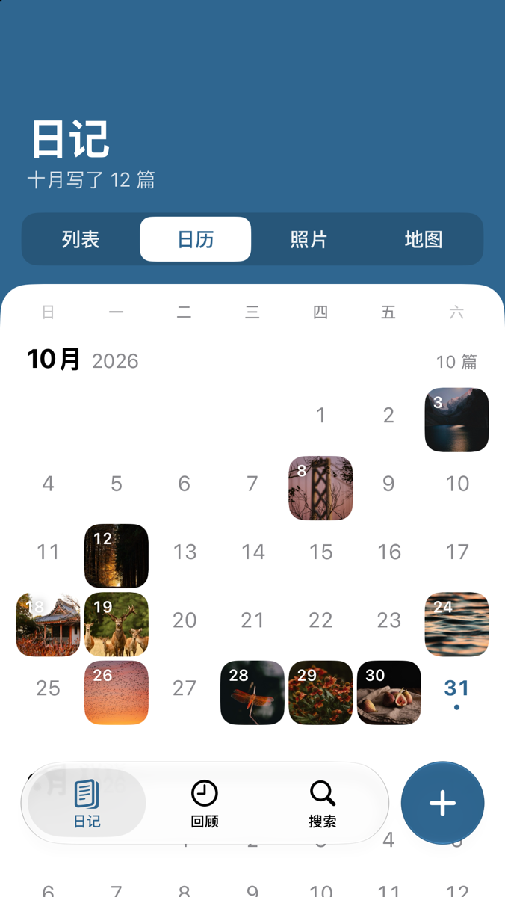

<p align="center">
  
</p>

<h1 align="center">照片日记 · PhotoDiary</h1>

<p align="center">把日记直接写在 iPhone 照片的“说明”里。<br>
不复制、不存储照片；日记随照片经 iCloud 同步，在系统照片 App 里也能看到、能搜到。</p>

<p align="center">
  
  
  
  
</p>

## 为什么

Apple 的“手记”App 会为附加的照片保存一份副本，内容锁在手记里。照片日记反过来：**在原照片上标注**，日记就是照片说明本身。微单拍的大文件不会多占一份空间，删掉本 App 也不会丢日记。

写日记有两个入口：本 App，或者照片 App 的说明栏。两边的修改互相同步，始终以照片说明为准。

## 功能

- **双向同步**：照片 App 里改的说明，打开本 App 就能看到（运行中实时，关闭期间按 change token 增量）
- **日记**：按月分组的时间线，另有日历、照片网格、地图三种视图，切换时背景不动、只换内容
- **编辑器**：微博式 `#话题#` 标签，输入 `#` 弹出用过的标签；保存时自动补写作日期；可以给旧照片“追加感想”
- **回顾**：那年今日、本周写作、还没写日记的照片
- **标签**：标签自动同步为照片关键词；支持批量改名、合并
- **搜索**：全文、标签、日期范围
- **长按预览**：列表、日历、网格里长按一篇，预览照片并直接追加感想、编辑、分享
- **Apple Watch**：最近的日记、那年今日、本周写作和还没写的照片同步到手表；在表上口述一段，由 iPhone 写进照片说明
- **iPad**：系统标签栏（可展开成侧栏）、多栏卡片、自适应网格、正文限宽
- **外观**：浅色 / 深色 / 跟随系统；九种主题色，也可以用调色板自选
- **多语言**：简体中文、日本語、English，地名跟随界面语言；系统语言不在其中时用英语
- 照片、视频、实况照片都可以写；支持“有限访问”；全部日记可导出为 Markdown

## 说明格式

纯文本，脱离 App 在照片 App 里看也自然：

```
风很舒服，第一次用新镜头拍日落 #旅行# #镜头测试#
— 2026.10.31

三年后再看，还是喜欢这张
— 2029.11.02
```

- 每段末尾一行 `— YYYY.MM.DD` 是写作日期；追加感想时空一行再写新段落
- `#话题#` 是标签，半角、全角 `＃` 都能识别，最长 20 字；照片关键词完全由标签生成
- 照片 App 里直接写的说明（没有日期行）同样是日记；保存时自动补上日期行
- 相机自动写入的说明（如 `FUJIFILM DIGITAL CAMERA GFX100RF`、`OLYMPUS DIGITAL CAMERA`、`SONY DSC`）会被忽略，写日记时直接覆盖
- 解析失败时原文照常显示，App 不会擅自改写用户在别处写的文字

## 技术

- SwiftUI + Swift 6，最低 **iOS 27**：PhotoKit 从 iOS 27 起才公开说明和关键词的读写接口（`PHAsset.extendedMetadata`、`PHAssetChangeRequest.caption`、`addKeyword(_:)`）
- 照片说明是唯一正本，本地只保存可重建的索引：SwiftData 数据库（`Application Support/Index/`，不进 iCloud 备份），每张带说明的照片一行，连同解析好的结果；地名缓存单独一个库
- 首次启动后台分批遍历照片库，建好的部分先显示；之后用 `PHPhotoLibraryChangeObserver` 和 `fetchPersistentChanges(since:)` 增量同步，只重读变化的照片，也只写变化的行
- 日志用 `os.Logger`，subsystem 为 `com.kejincai.photodiary`；设置里可以导出本次运行的诊断日志（不含日记正文）
- 照片日期按拍摄地当地时区计算，和照片 App 一致
- 界面遵循 Apple 的设计原则：Liquid Glass 浮动标签栏（往下滚收起成小胶囊）、临界阻尼弹簧动画、zoom 转场、下拉拉伸照片、日记正文用宋体（系统按需下载）；适配深色模式、动态字体（辅助功能大字号下行内容改成上下排，浮动控件长按显示大字）、VoiceOver（日记读成完整的句子，长按菜单里的操作可以直接选，下拉清除等手势有对应的按钮）、切换控制、“减少动态效果”、“降低透明度”、“增强对比度”和“粗体文本”
- Apple Watch 通过 WatchConnectivity 同步：快照（不含图）走 applicationContext，缩略图按需逐张拉取并缓存在表上；表上口述的段落可达时直接送达，否则排队
- 图标和开屏是同一个图形：一张正在显影的拍立得，白边上写着一行字。开屏动画里照片慢慢显影、字自己写出来；首次读取照片库时，读取进度就是显影进度（`Tools/AppIcon/make-icon.swift` 生成图标和启动画面，几何和 `Shared/Design/Mark.swift` 一致）

## 工程结构

```
Shared/          iPhone 和 Apple Watch 共用：说明格式、日期、条目模型、品牌图形、同步数据结构
PhotoDiary/      iPhone/iPad App
  App/           入口、路由、日志、Watch 连接
  Design/Theme   主题色、字体、动效、尺寸（Metrics）
  Design/Components  可复用组件：卡片、行、胶囊、分段控件、上下文菜单、效果
  Library/       照片库读写、索引数据库、地名
  Views/         按页面分组
PhotoDiaryWatch/ Apple Watch App
PhotoDiaryTests/ 单元测试（假照片库）和真实照片库测试
PhotoDiaryUITests/ 界面测试：每一条用户操作走一遍
Tools/           测试脚本、图标生成、测试照片导入
```

用 [XcodeGen](https://github.com/yonaskolb/XcodeGen) 生成工程：`xcodegen generate`。开屏动画可以用 `-holdSplash` 启动参数多停几秒，方便截图。

```
PhotoDiary/
├── App/          入口、导航
├── Model/        说明格式解析（CaptionFormat）、日记条目
├── Library/      照片库扫描与写入、索引数据库、缩略图、地名
├── Design/       主题色、字体、动效、通用组件
└── Views/        日记、详情、编辑器、从照片添加、回顾、搜索、设置
```

## 构建

需要 Xcode 27 和 iOS 27 SDK。

```bash
open PhotoDiary.xcodeproj
```

工程由 [XcodeGen](https://github.com/yonaskolb/XcodeGen) 从 `project.yml` 生成，改了工程配置后重新生成：

```bash
xcodegen generate
```

### 测试

一条命令跑全部（Watch App 编译、单元测试、真实照片库测试、界面测试）：

```bash
Tools/test.sh
```

脚本在一台专用的模拟器“照片日记 自动测试”上跑（没有就新建），不碰平时看效果用的模拟器。`Tools/test.sh unit` 只跑单元测试，`Tools/test.sh ui` 只跑界面测试，`--fresh` 先抹掉模拟器、重新导入测试照片（`Tools/TestPhotos/seed.sh`：不联网，3 张带日记、3 张空白）。

三层测试：

- **单元测试**（`PhotoDiaryTests/`）：内存里的假照片库（`Support/FakeLibrary.swift`），覆盖说明格式、同步、索引、写入、标签改名、Watch 消息。假照片库可以让增量读取、全量读取停在半路，用来测“同步和保存同时发生”。
- **真实照片库测试**（`PhotoKitIntegrationTests`）：在测试模拟器的照片库里造照片和视频，真的写说明、关键词，读增量、取图取视频。PhotoKit 在哪条线程回调只有这里测得到。会往照片库里加照片，所以默认不跑，`Tools/test.sh` 用 `TEST_RUNNER_PHOTODIARY_PHOTOKIT_TESTS=1` 打开；每个测试结束后清掉自己写的说明。
- **界面测试**（`PhotoDiaryUITests/`）：像用户一样点完每一条流程——写日记、追加、编辑、清除、取消、删除、长按菜单、标签补全和改名、四种视图、日历、大图、分享、搜索、回顾、设置（外观、主题色、语言、一周起始日、隐藏的说明、导出、重建索引）。每次保存后都确认 App 还在前台。App 收到 `-uiTesting` 时关掉动画、从“跟随系统”的语言开始。

1 万篇日记规模的耗时测试默认不跑，加 `TEST_RUNNER_PERF=1` 运行（`PhotoDiaryTests/PerformanceTests.swift`）。

### 测试照片

`Tools/TestPhotos/fetch.sh` 会从 Unsplash 下载 24 张照片，写入拍摄日期、GPS 和日记说明，然后导入到已启动的模拟器：

```bash
Tools/TestPhotos/fetch.sh
```

照片来自 [Unsplash](https://unsplash.com/t/wallpapers)，遵循 [Unsplash License](https://unsplash.com/license)。

### 图标

`Tools/AppIcon/make-icon.swift` 生成浅色、深色、着色三个版本的图标：

```bash
swift Tools/AppIcon/make-icon.swift PhotoDiary/Assets.xcassets/AppIcon.appiconset
```

## 待在真机上验证

- 修改说明时是否每张都弹出系统确认（模拟器上不弹）
- 照片 App 能否搜到 `#话题#` 和长说明靠后的文字
- 共享图库中照片的说明对其他成员是否可见（目前用 `sourceType` 判断是否显示提醒，可能不准）
- 数万张照片规模下首次建索引的耗时

## 许可

[MIT](LICENSE)
